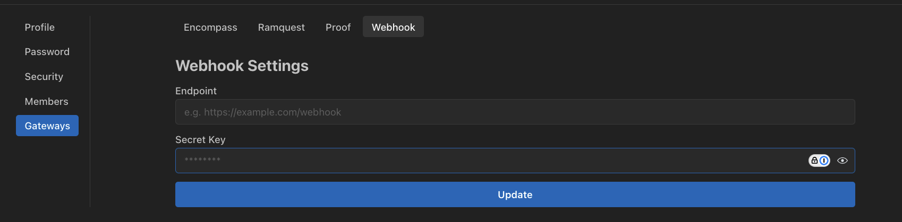

We support webhooks for event-based notifications.

Your **Organization Administrators** can configure webhooks for the following events:

- Document Processing
- CDBalancer
- Copilot Task Groups

We send a POST request to the webhook URL with the following payload:

## Configuration

You can setup webhooks from the **Organization Settings/Gateways/Webhooks** page.



```python title="Webhook Models" showLineNumbers

class ProcessingCompletedMessage(BaseModel):
    class Meta(BaseModel):
        upload_session_id: str

    class Data(BaseModel):
        status: Status
        error: Optional[str]

    type: str = 'PROCESSING_COMPLETED'
    meta: Meta
    data: Data

"""
📋 HEADERS:
--------------------------------------------------------------------------------
Host: ab52f05e83fe.ngrok-free.app
User-Agent: python-httpx/0.28.1
Content-Length: 217
Accept: */*
Accept-Encoding: gzip, deflate
Traceparent: 00-0199e776afd66719e9646f175ae2e851-68c0b5e7d0691aca-01
X-Areal-Request-Id: 7d791938-73cd-4a8a-a752-5fc54ee72809
X-Areal-Timestamp: 1760525013
X-Areal-Webhook-Signature: 0e9550e546baff4362f65f21c3f1d924a8c3add70f8737f1db22cb5c8c83e119
X-Forwarded-For: 52.8.69.203
X-Forwarded-Host: ab52f05e83fe.ngrok-free.app
X-Forwarded-Proto: https

📦 BODY:
--------------------------------------------------------------------------------
{
  "data": {
    "error": null,
    "status": "completed"
  },
  "meta": {
    "upload_session_id": "fc2f43a2-2781-46cb-ace2-b84f17dbfe29"
  },
  "request_id": "7d791938-73cd-4a8a-a752-5fc54ee72809",
  "timestamp": 1760525013,
  "type": "PROCESSING_COMPLETED"
}

"""
```

## Copilot Task Groups

We send `COPILOT_TASK_GROUP_EXECUTED` once each time a Task Group finishes running on an
Upload Session. We don't send a message per Task, or when a Task's plan is generated.

| When | `data.status` |
| --- | --- |
| Every active Task has finished, and the Task Group has no post-run action | `completed`, or `failed` if a Task failed |
| The post-run action has finished | `completed`, or `failed` if a Task or the post-run action failed |
| The starting condition didn't pass | `skipped` |
| The starting condition errored | `failed`, with the error in `data.error` |

`data.tasks` holds the latest result of each active Task in the Task Group. A Task that
has never run on the Upload Session is left out. `data.post_run_action` is `null` when the
Task Group has no post-run action.

```python title="Copilot Task Group Models" showLineNumbers

class CopilotTaskResult(BaseModel):
    task_id: str
    name: str
    status: Literal['pending', 'success', 'failed', 'n/a']
    error: Optional[str]
    summary: Optional[str]  # description of the Task's last step


class CopilotTaskGroupExecutedMessage(BaseModel):
    class Meta(BaseModel):
        upload_session_id: str
        task_group_id: str

    class Data(BaseModel):
        status: Literal['completed', 'failed', 'skipped']
        error: Optional[str]  # the starting condition's error
        tasks: list[CopilotTaskResult]
        post_run_action: Optional[CopilotTaskResult]

    type: str = 'COPILOT_TASK_GROUP_EXECUTED'
    meta: Meta
    data: Data

"""
📦 BODY:
--------------------------------------------------------------------------------
{
  "data": {
    "error": null,
    "post_run_action": {
      "error": null,
      "name": "Send summary email",
      "status": "success",
      "summary": "Sent the summary email to the loan officer",
      "task_id": "6f1c2b7e-3a4d-4e8f-9b0a-1c2d3e4f5a6b"
    },
    "status": "completed",
    "tasks": [
      {
        "error": null,
        "name": "Verify borrower name",
        "status": "success",
        "summary": "Borrower name matches the W-2",
        "task_id": "0a9b8c7d-6e5f-4a3b-2c1d-0e9f8a7b6c5d"
      }
    ]
  },
  "meta": {
    "task_group_id": "3e2d1c0b-9a8f-4e7d-6c5b-4a3f2e1d0c9b",
    "upload_session_id": "fc2f43a2-2781-46cb-ace2-b84f17dbfe29"
  },
  "request_id": "8e8a2f4c-1b7d-4c3e-9a6f-2d5b7c9e1f3a",
  "timestamp": 1760525013,
  "type": "COPILOT_TASK_GROUP_EXECUTED"
}

"""
```
