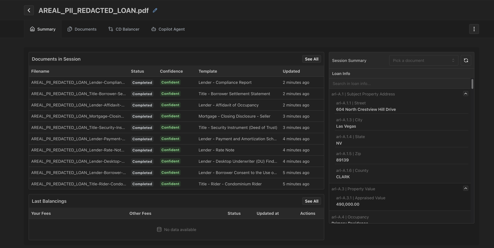
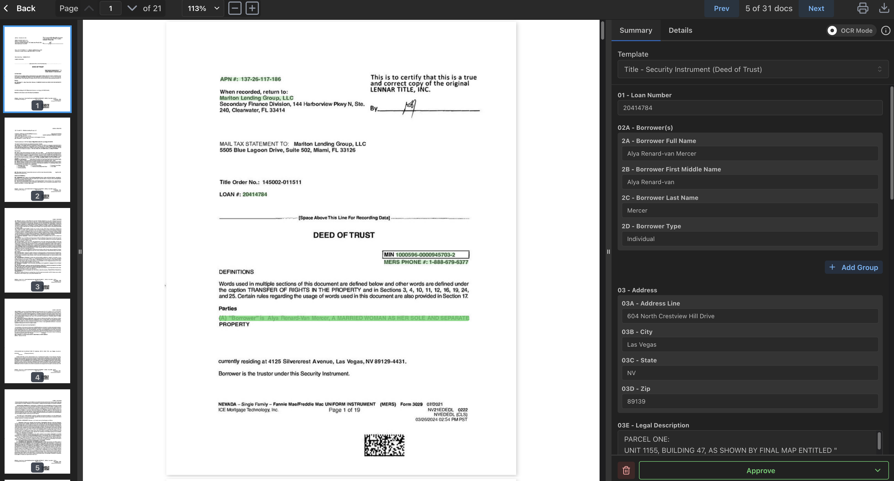

import { Code, TabItem, Tabs } from '@astrojs/starlight/components';
import sessions_python_get_upload_session_details from '../../code_samples/sessions/python/get_upload_session_details.py?raw';
import sessions_csharp_get_upload_session_details from '../../code_samples/sessions/csharp/get_upload_session_details.cs?raw';
import sessions_java_get_upload_session_details from '../../code_samples/sessions/java/get_upload_session_details.java?raw';

When you upload a document to Areal for processing, we create a loan — a grouping of documents for that mortgage. The API calls this an `UploadSession`.

:::caution[One loan per mortgage]
Create a new loan for each mortgage. In the API that is one `UploadSession` per loan.
See [Processing](processing/processing.md) for more details.
:::

## Link a loan to your LOS

If your organization requires every new loan to belong to a loan in your loan origination system (LOS), send that loan's identifier in `external_references` with the first upload (`POST /processing/upload/`):

| LOS | Field | Value |
|---|---|---|
| Encompass | `encompass_loan_number` or `encompass_loan_id` | The loan number, or the loan GUID |
| MeridianLink | `meridianlink_loan_number` | The loan number |
| Byte | `byte_file_data_id` | The loan's **File Name** as shown in Byte (for example `TX020009784`), or its FileDataID |

To pull a loan's documents from your LOS into Areal, call `POST /processing/sync_gateway_loan/` with the same identifier as `loan_number`.

:::note[Byte File Names]
A Byte File Name is matched exactly; letter case and surrounding spaces don't matter. If the value names more than one Byte loan (two loans share the File Name, or it is one loan's File Name and another loan's FileDataID), the request is refused with a message listing the loans. Send that loan's other identifier instead.
:::

## Example Views

### List View

### Detail View

## Example Usage

<Tabs>
  <TabItem label="Python">
    <Code code={sessions_python_get_upload_session_details} lang="python" title="Get loan details" />
  </TabItem>
  <TabItem label="C#">
    <Code code={sessions_csharp_get_upload_session_details} lang="csharp" title="Get loan details" />
  </TabItem>
  <TabItem label="Java">
    <Code code={sessions_java_get_upload_session_details} lang="java" title="Get loan details" />
  </TabItem>
</Tabs>

For technical details see the [UploadSession API](https://dev-api.v2.areal.ai/api/v2/docs#/sessions).
